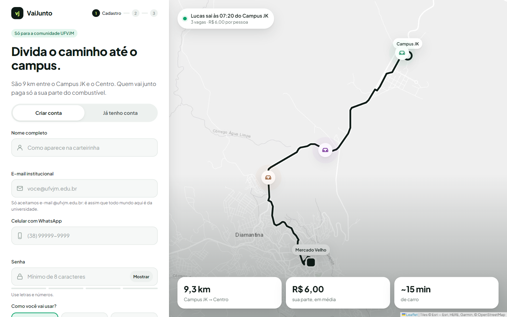
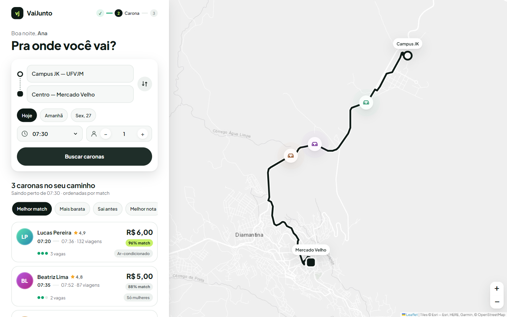
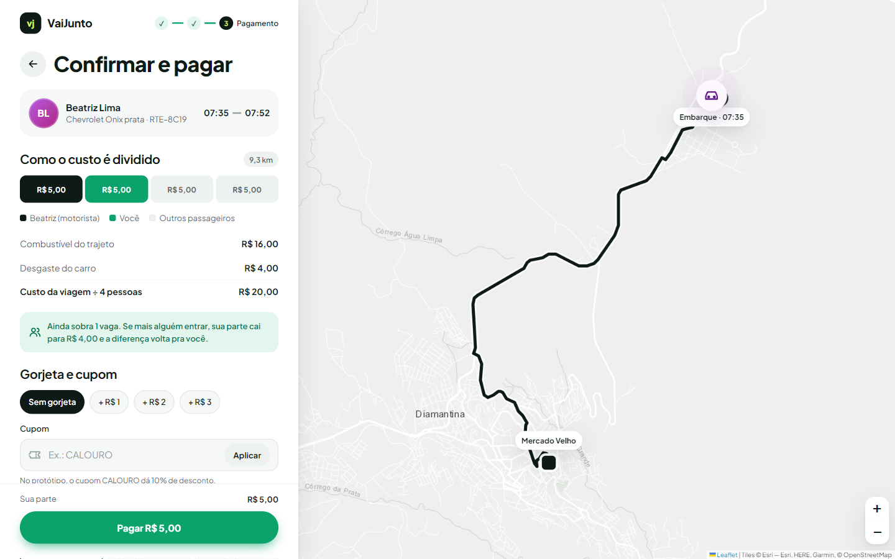
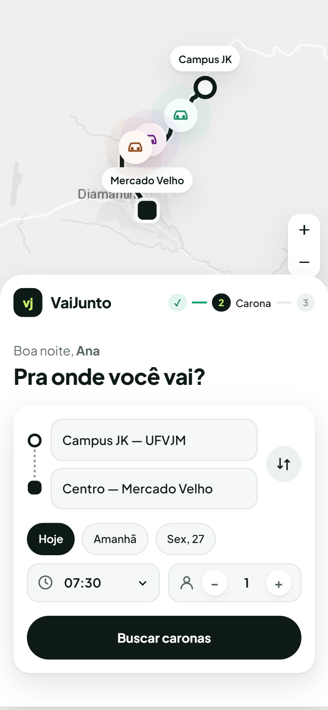

# VaiJunto — Entrega da subequipe de desenvolvimento

Atividade **Protótipo de Interface e Teste de Usabilidade** · Gestão de Projetos de Software · 8º período · UFVJM

Repositório: https://github.com/cm0420/vaijunto-poc

Este documento resume as fases do desenvolvimento, os commits de cada pessoa e os prints que cada dev entrega.

---

## 1. Time e janelas de horário

| Papel | Pessoa | Tela / responsabilidade | Janela de comunicação |
|---|---|---|---|
| Dev 1 | Miguel | Cadastro / Autenticação (`cadastro/`) | 00h00 às 12h00 |
| Dev 2 | Maria | Busca e Match de Caronas (`busca/`) | 12h00 às 23h59 |
| Dev 3 | Humberto | Pagamento e Divisão de Custos (`pagamento/`) | 00h00 às 12h00 |
| Integração | Yago | Junta as 3 telas num fluxo único (`shared/`, `index.html`) | 12h00 às 23h59 |

Dependências que atravessam janelas (só se resolvem no período seguinte):

- **Cadastro → Busca:** o nome digitado no cadastro (Miguel, manhã) é exibido na busca (Maria, tarde).
- **Busca → Pagamento:** a carona escolhida na busca (Maria, tarde) define valores e motorista no pagamento (Humberto, manhã).
- **Integração:** Yago está na janela da tarde, mas depende de Miguel e Humberto (manhã). Por isso a integração sempre fecha no período seguinte ao das telas.

O contrato entre telas foi fixado pela URL (`?nome=…&carona=…`) e pelos dados compartilhados em `shared/caronas.js`, para que cada dev pudesse trabalhar sem esperar o outro.

---

## 2. Fases

### Fase 1 — Combinados e divisão

- Leitura do enunciado e divisão das 3 telas + integração.
- Escopo: só o **caminho feliz**, dados mockados, sem backend nem banco de dados; abre direto no navegador.
- Trajeto escolhido: Campus JK → Centro de Diamantina.

### Fase 2 — Telas isoladas (v1)

Cada dev construiu sua tela sozinho, com uma base visual provisória copiada em cada CSS.

| Commit | Pessoa | O que entrou |
|---|---|---|
| `179df2b` | Miguel (Dev 1) | Tela de cadastro com abas Criar conta / Entrar e tela de sucesso |
| `55326a3` | Maria (Dev 2) | Busca com lista de caronas por match e detalhe em bottom sheet |
| `e506baa` | Humberto (Dev 3) | Pagamento com divisão de custo, Pix/cartão/dinheiro e recibo |

### Fase 3 — Primeira integração (v1)

| Commit | Pessoa | O que entrou |
|---|---|---|
| `85da942` | Yago (Integração) | Base visual extraída para `shared/base.css`, dados únicos em `shared/caronas.js`, links entre as telas, barra de etapas, `index.html` de entrada |

Problema encontrado no teste da v1: estados que deviam ficar escondidos (login, sucesso, confirmação) apareciam todos juntos, porque o `display` do CSS anulava o atributo `hidden`.

### Fase 4 — Revisão e v2

A v1 cumpria o enunciado, mas tinha cara de wireframe. O time decidiu manter o mock, só que com cara de produto: mapa real, validação, estados de carregamento e animações. A integração veio primeiro desta vez, para as telas já nascerem sobre a mesma base.

| Commit | Pessoa | O que entrou |
|---|---|---|
| `0b85c77` | Yago (Integração) | Design system v2, rota real Campus JK → Centro gravada no arquivo, mapa Leaflet, ícones, transições, toast; correção do `[hidden]` |
| `956a544` | Miguel (Dev 1) | Cadastro com validação em tempo real, código de verificação de 4 dígitos, login e mapa ao vivo |
| `9c52f9c` | Maria (Dev 2) | Busca com autocomplete, skeleton, ordenação animada, carros no mapa e detalhe do motorista |
| `d26ae94` | Humberto (Dev 3) | Pagamento com barra de cotas, gorjeta, cupom, Pix com contador, cartão com preview, confete e acompanhamento da viagem |

### Fase 5 — Verificação

- Fluxo completo rodado em navegador automatizado (Playwright/Chromium), em **desktop (1440×900)** e **celular (390×844)**.
- Resultado: nenhum erro de JavaScript; os prints abaixo saíram dessa execução.
- Bugs achados e corrigidos nessa fase: botão preso invisível (transição CSS de `opacity` disputando com o GSAP), carros sumindo do mapa (mesmo motivo com `transform`), lista de sugestões atrás dos filtros, mapa no fim da página no celular, pins sobrepostos.

### Fase 6 — Entrega

Um commit por pessoa com os prints da própria tela, mais este documento (commit da Integração).

---

## 3. Prints que cada dev entrega

Todos os prints estão em `docs/prints/`, em versão desktop e celular (`-mobile`).

### Dev 1 — Miguel · Cadastro (`docs/prints/dev1-miguel/`)

| Print | Mostra |
|---|---|
| `cadastro-1-vazio` | Formulário vazio, mapa ao vivo com carros e números da rota |
| `cadastro-2-erros` | Envio sem preencher: erro embaixo de cada campo |
| `cadastro-3-preenchido` | Campos válidos com check verde e senha forte |
| `cadastro-4-codigo` | Código de verificação de 4 dígitos preenchido |
| `cadastro-5-pronto` | "Tudo pronto" com cartão do perfil e botão para buscar carona |

### Dev 2 — Maria · Busca e Match (`docs/prints/dev2-maria/`)

| Print | Mostra |
|---|---|
| `busca-1-inicio` | Card de busca com rota, dia, horário e passageiros |
| `busca-2-autocomplete` | Sugestões de lugares |
| `busca-3-carregando` | Skeleton enquanto busca |
| `busca-4-resultados` | Caronas ordenadas por match |
| `busca-5-filtro-preco` | Lista reordenada por preço |
| `busca-6-detalhe` | Perfil do motorista, embarque no mapa e "Reservar vaga" |

### Dev 3 — Humberto · Pagamento e Divisão (`docs/prints/dev3-humberto/`)

| Print | Mostra |
|---|---|
| `pagamento-1-divisao` | Barra de cotas e conta da divisão do custo |
| `pagamento-2-gorjeta-cupom` | Gorjeta + cupom CALOURO aplicados, total atualizado |
| `pagamento-3-cartao` | Cartão com preview ao vivo |
| `pagamento-4-confirmado` | "Vaga garantida" com recibo e confete |
| `pagamento-5-acompanhar` | Viagem em andamento no mapa |

### Integração — Yago · Fluxo completo (`docs/prints/integracao-yago/`)

| Print | Mostra |
|---|---|
| `fluxo-1-cadastro-1-vazio` | Entrada do fluxo |
| `fluxo-2-busca-1-inicio` | Nome do cadastro chegando na busca, etapa 2 marcada |
| `fluxo-3-busca-6-detalhe` | Carona escolhida |
| `fluxo-4-pagamento-1-divisao` | Mesma carona chegando no pagamento, etapa 3 |
| `fluxo-5-pagamento-4-confirmado` | Confirmação |
| `fluxo-6-pagamento-5-acompanhar` | Fim do fluxo |

---

## 4. Como rodar

Abra `index.html` no navegador. Precisa de internet só para fontes, GSAP, Leaflet e as imagens do mapa.

Dados de teste do caminho feliz:

- E-mail: qualquer um terminando em `@ufvjm.edu.br`
- Celular: 11 dígitos · Senha: 8+ caracteres
- Código de verificação: qualquer 4 dígitos (ex.: `2611`)
- Cupom: `CALOURO`

Motoristas, avaliações, placas e valores são fictícios.
