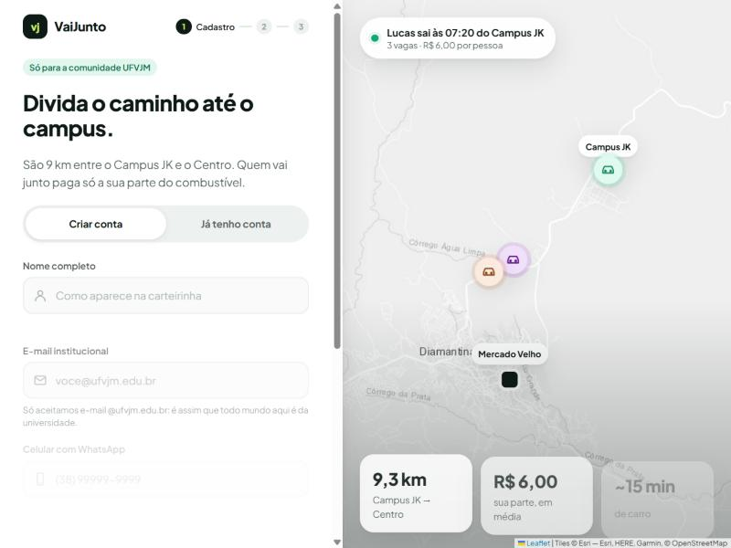
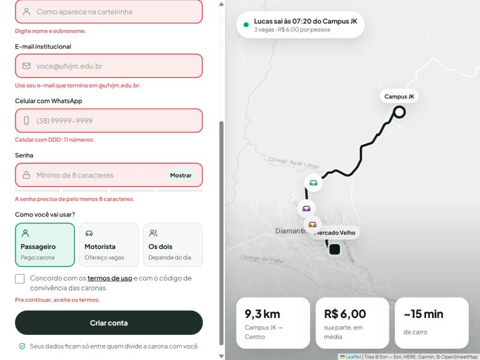
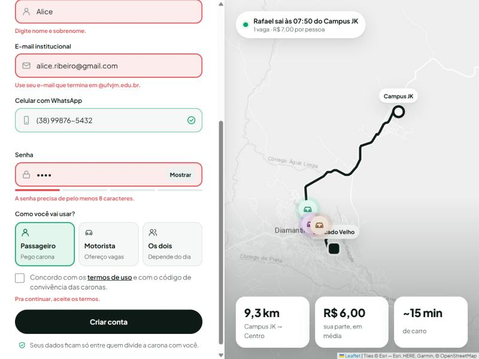
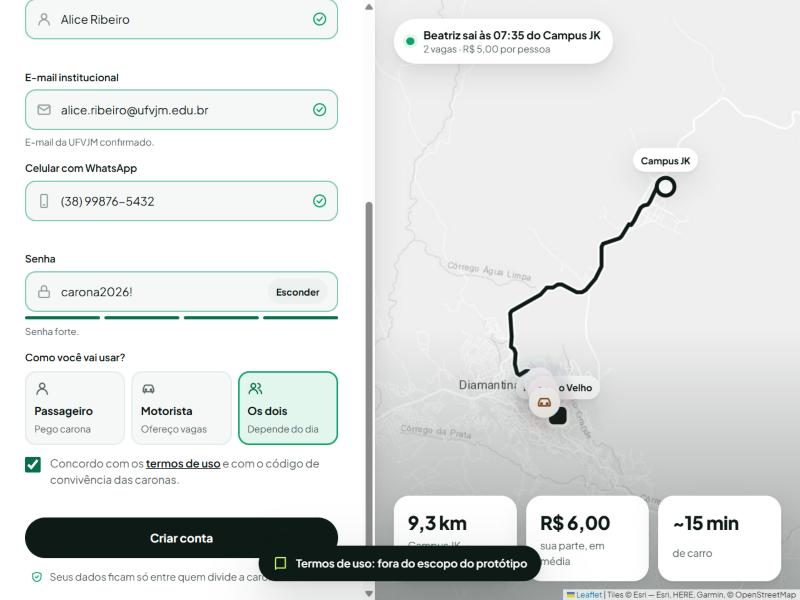
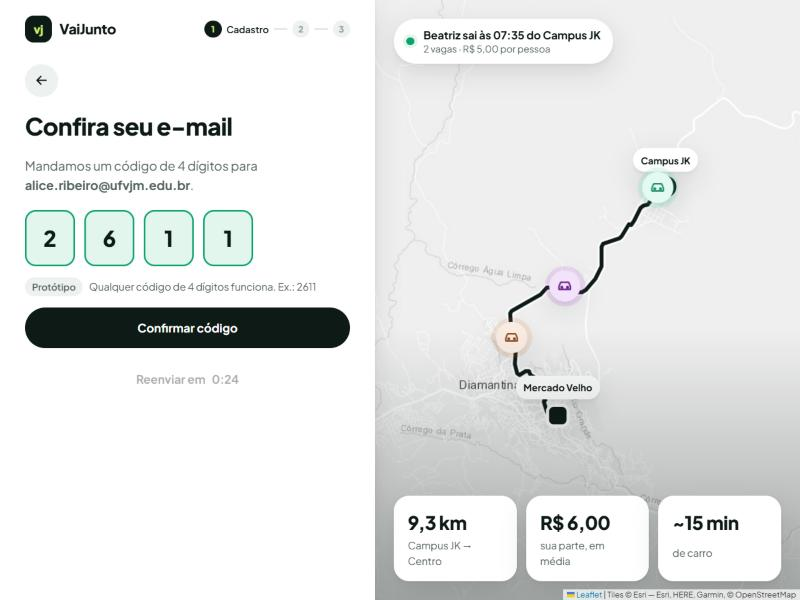
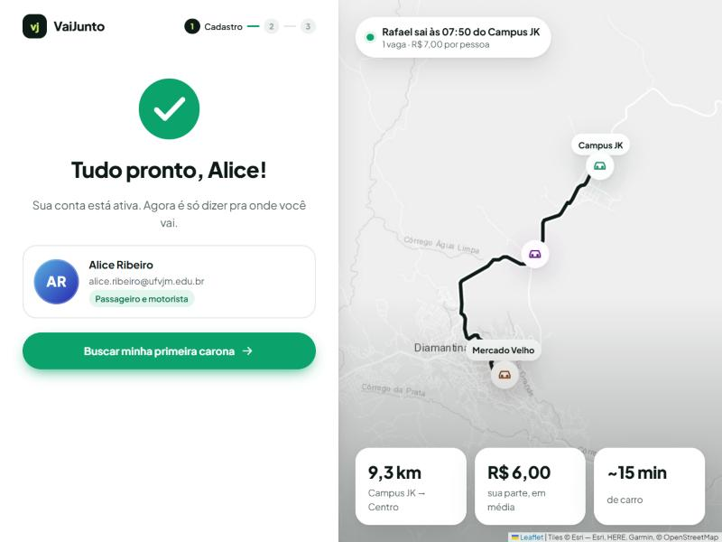
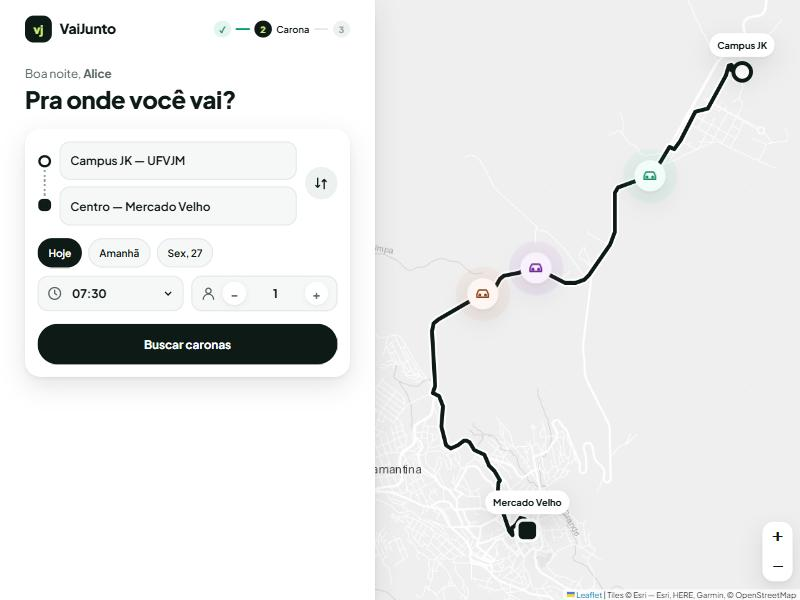
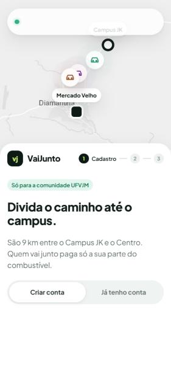

# Teste fixo 1 — Cadastro de novo usuário

| | |
|---|---|
| **Tipo** | Teste fixo de funcionalidade |
| **Responsável** | Tester 1 — Ana Clara |
| **Data** | 25/11/2026 |
| **Protótipo** | VaiJunto (`vaijunto-poc`), tela `cadastro/` (Dev 1 Miguel) + passagem para `busca/` (Integração Yago) |
| **Ambiente** | Navegador Chromium, servidor local (`python -m http.server`), tela de computador (800×600) e de celular (375×812) |
| **Resultado** | **Concluído com sucesso**: a conta foi criada e o usuário chegou à tela de Busca com o próprio nome |

---

## 1. Tarefa pedida

> "Cadastre-se no sistema como um novo usuário, do início ao fim."

O teste começa na tela de entrada (`index.html`) e termina quando o usuário chega à tela de Busca já identificado.

### Persona e dados usados

Uma estudante da UFVJM que vai usar o app pela primeira vez, como passageira e às vezes motorista.

| Campo | Valor final usado |
|---|---|
| Nome completo | Alice Ribeiro |
| E-mail institucional | alice.ribeiro@ufvjm.edu.br |
| Celular | (38) 99876-5432 |
| Senha | `carona2026!` (fictícia, só para o teste) |
| Perfil | Os dois (passageiro e motorista) |
| Código de verificação | 2611 |

Para testar o retorno visual, alguns erros foram cometidos **de propósito** antes de preencher os dados corretos, como um usuário real costuma fazer (enviar vazio, esquecer o sobrenome, usar o Gmail, senha curta).

---

## 2. Execução passo a passo

| # | Ação do usuário | O que aconteceu | Resultado |
|---|---|---|---|
| 1 | Abriu o protótipo | Abre direto em "Criar conta", com o título "Divida o caminho até o campus.", abas *Criar conta / Já tenho conta* e o mapa da rota ao lado. Etapa **1 Cadastro** marcada no topo. | OK |
| 2 | Clicou em **Criar conta** com tudo vazio | Todos os campos ficaram vermelhos com uma mensagem embaixo de cada um ("Digite nome e sobrenome.", "Use seu e-mail que termina em @ufvjm.edu.br.", "Celular com DDD: 11 números.", "A senha precisa de pelo menos 8 caracteres.", "Pra continuar, aceite os termos."). O cursor foi para o primeiro campo com erro. | OK |
| 3 | Digitou só "Alice" no nome | Continuou o erro "Digite nome e sobrenome." | OK |
| 4 | Digitou `alice.ribeiro@gmail.com` | Erro: "Use seu e-mail que termina em @ufvjm.edu.br." | OK |
| 5 | Digitou `38998765432` no celular | Máscara aplicada sozinha: **(38) 99876-5432**. Campo ficou verde com ícone de confirmação. | OK |
| 6 | Digitou a senha `caro` (4 caracteres) | Barra de força com 1 traço vermelho e o erro de mínimo de 8 caracteres. | OK |
| 7 | Corrigiu o nome para "Alice Ribeiro" | Campo ficou verde com ícone de confirmação na hora, sem precisar sair do campo. | OK |
| 8 | Corrigiu o e-mail para `alice.ribeiro@ufvjm.edu.br` | Campo verde e a mensagem "E-mail da UFVJM confirmado." | OK |
| 9 | Mudou a senha para `carona`, depois `carona2026` e por fim `carona2026!` | 6 caracteres: erro continua. 10 caracteres com número: "Boa senha." (3 traços). Com símbolo: "Senha forte." (4 traços verdes). | OK |
| 10 | Clicou em **Mostrar** | A senha apareceu em texto e o botão virou **Esconder**. | OK |
| 11 | Escolheu o perfil **Os dois** | O cartão ficou destacado em verde; "Passageiro" foi desmarcado. | OK |
| 12 | Clicou no link **termos de uso** | Aviso no rodapé: "Termos de uso: fora do escopo do protótipo". Os termos não abrem. | Ressalva (P3) |
| 13 | Marcou "Concordo com os termos…" | O erro dos termos sumiu. | OK |
| 14 | Clicou em **Criar conta** | O botão mostrou um carregamento (spinner) e a tela passou para **"Confira seu e-mail"**, mostrando o e-mail digitado (alice.ribeiro@ufvjm.edu.br). | OK |
| 15 | Tentou digitar a letra "a" no código | Ignorada, só números entram. | OK |
| 16 | Digitou 2, 6, 1, 1 | Cada número pula sozinho para a próxima caixa. Com os 4 dígitos, o botão **Confirmar código** foi liberado. | OK |
| 17 | Esperou o contador "Reenviar em 0:30" e clicou em **Reenviar código** | Aviso "Código reenviado". O botão continuou ativo, sem novo contador. | Ressalva (P2) |
| 18 | Clicou em **Confirmar código** | Tela **"Tudo pronto, Alice!"** com selo verde, cartão do perfil (avatar "AR", Alice Ribeiro, e-mail, etiqueta "Passageiro e motorista") e o botão **Buscar minha primeira carona**. | OK |
| 19 | Clicou em **Buscar minha primeira carona** | Abriu a tela de Busca com "Boa noite, **Alice**", a etapa 1 marcada como concluída e a etapa **2 Carona** como atual. | OK |

Nenhum erro apareceu no console do navegador durante o teste.

### Teste rápido no celular (375×812)

A tela de cadastro abre com o mapa ocupando a parte de cima e o formulário embaixo, em um painel que sobe. Os campos e o botão funcionam igual, mas é preciso rolar a página para chegar aos campos (ver P5).

---

## 3. Prints

| | |
|---|---|
|  **1. Tela inicial** |  **2. Envio com tudo vazio** |
|  **3. Nome sem sobrenome, Gmail e senha curta** |  **4. Tudo válido, perfil "Os dois" e aviso dos termos** |
|  **5. Código de verificação preenchido** |  **6. "Tudo pronto, Alice!"** |
|  **7. Busca abrindo com o nome do cadastro** |  **8. Cadastro no celular** |

---

## 4. Problemas de usabilidade encontrados

Nenhum problema impediu a tarefa. Os pontos abaixo são melhorias.

**Gravidade:** Alta (impede ou confunde muito) · Média (atrapalha, mas o usuário contorna) · Baixa (detalhe)

| # | Gravidade | Onde | Problema | Sugestão |
|---|---|---|---|---|
| P1 | Média | Campo **Senha** | O texto de ajuda diz "Use letras e números.", o que parece uma regra, mas o sistema aceita qualquer senha com 8 caracteres (ex.: só letras). A regra real só aparece quando o usuário erra. | Deixar a regra explícita desde o início: "Mínimo de 8 caracteres. Letras e números deixam a senha mais forte." |
| P2 | Baixa | Tela do código, **Reenviar código** | Depois do primeiro reenvio o botão fica sempre ativo, sem novo contador. Dá para clicar várias vezes seguidas e receber o mesmo aviso, sem saber se algo mudou. | Reiniciar o contador de 30 s a cada reenvio. |
| P3 | Baixa | Link **termos de uso** | O usuário precisa aceitar termos que não consegue ler (o link só mostra "fora do escopo do protótipo"). | Abrir um resumo curto dos termos (mesmo que fictício) num modal. |
| P4 | Baixa | Tela do código | Ao completar os 4 dígitos é preciso ainda clicar em **Confirmar código**. Num código de 4 dígitos é comum o app confirmar sozinho. | Confirmar automaticamente ao preencher o 4º dígito (mantendo o botão como alternativa). |
| P5 | Baixa | Celular | O mapa ocupa a parte de cima da tela e o formulário começa mais abaixo; o usuário precisa rolar para chegar aos campos e ao botão **Criar conta**. | Diminuir a altura do mapa no cadastro em telas pequenas, já que ele não é interativo nesta etapa. |
| P6 | Baixa | Aviso (toast) no computador | O aviso aparece centralizado na janela inteira, metade sobre o formulário e metade sobre o mapa, cobrindo o texto "Seus dados ficam só entre quem divide a carona com você." | Centralizar o aviso dentro do painel do formulário. |

## 5. Pontos positivos

- **Retorno visual imediato:** cada campo fica verde com ícone de confirmação ou vermelho com uma mensagem clara já durante a digitação.
- **Mensagens de erro específicas,** que dizem o que fazer ("Digite nome e sobrenome.", "Celular com DDD: 11 números.").
- **Máscara do celular** automática e **medidor de força da senha** com texto.
- **Botão Mostrar/Esconder** senha.
- **Spinner** nos botões, deixando claro que algo está acontecendo.
- **O código só aceita números** e pula sozinho para a próxima caixa.
- **Dica do protótipo** na tela do código ("Qualquer código de 4 dígitos funciona. Ex.: 2611") evita que o testador fique travado.
- **Continuidade:** o nome, o e-mail e o perfil digitados aparecem no resumo final, e o primeiro nome segue para a tela de Busca.
- **Barra de etapas** (1 Cadastro, 2 Carona, 3 Pagamento) mostra onde o usuário está no fluxo.

## 6. Conclusão

O Teste fixo 1 foi **concluído com sucesso** e sem erros. O cadastro é claro, com bom retorno visual e mensagens de erro que orientam o usuário, e a passagem para a tela de Busca funciona (o nome cadastrado aparece na saudação). Os seis pontos de melhoria encontrados são de gravidade média ou baixa e nenhum impediu a tarefa. O mais relevante é o **P1** (a regra da senha não fica clara).
