# Teste fixo 2 — Busca e confirmação de carona

| | |
|---|---|
| **Tipo** | Teste fixo de funcionalidade |
| **Responsável** | Tester 2 — _(nome)_ |
| **Data** | 26/11/2026 |
| **Protótipo** | VaiJunto (`vaijunto-poc`), tela `busca/` (Dev 2 Maria) + `pagamento/` (Dev 3 Humberto) + passagem entre telas (Integração Yago) |
| **Ambiente** | Navegador Chromium, servidor local (`python -m http.server`), tela de computador (1280×800) e de celular (375×812) |
| **Resultado** | **Concluído com ressalvas**: a busca, o detalhe e a reserva até "Vaga garantida!" funcionam nas duas telas, mas a quantidade de passageiros se perde no pagamento e o cartão é aprovado em branco |

---

## 1. Tarefa pedida

> "Busque uma carona do Campus JK para o Centro para 2 pessoas, veja os dados do motorista e reserve."

O teste começa na tela de Busca já identificado (vindo do cadastro, `?nome=Alice`) e termina na tela **"Vaga garantida!"** do pagamento.

### Persona e dados usados

A mesma estudante do Teste 1, que agora vai ao Centro com uma colega e quer reservar as duas vagas de uma vez.

| Campo | Valor usado |
|---|---|
| Usuária | Alice (vinda do cadastro) |
| Saindo de | Campus JK — UFVJM |
| Indo para | Centro — Mercado Velho |
| Dia / horário | Amanhã, 07:30 |
| Passageiros | **2** |
| Carona escolhida | Lucas Pereira (96% de match) |
| Pagamento | Cartão com os campos **em branco** (computador) e Pix (celular) |

---

## 2. Execução passo a passo

| # | Ação do usuário | O que aconteceu | Resultado |
|---|---|---|---|
| 1 | Abriu a Busca vindo do cadastro | Saudação "Boa tarde, **Alice**", título "Pra onde você vai?", etapa 1 concluída e **2 Carona** atual. Origem e destino já vêm preenchidos (Campus JK → Centro). | OK |
| 2 | Digitou "rodo" no destino | Lista de sugestões mostrou só "Rodoviária de Diamantina". | OK |
| 3 | Digitou "merc", desceu com a seta e deu Enter | Escolheu "Centro — Mercado Velho" pelo teclado; o campo pisca em verde. | OK |
| 4 | Clicou em **Inverter** duas vezes | Origem e destino trocam com animação e voltam ao original. | OK |
| 5 | Escolheu **Amanhã** e 07:30 | Chip "Amanhã" ficou destacado. | OK |
| 6 | Clicou 4 vezes em **+** passageiros e depois 1 vez em **−** | O contador para em **3** (limite) e volta para **2**. | OK |
| 7 | Clicou em **Buscar caronas** | Spinner no botão e 3 cartões cinza de carregamento (skeleton) por cerca de 1 s. | OK |
| 8 | Viu os resultados | "**2 caronas no seu caminho** · Saindo perto de 07:30 · ordenadas por match": Lucas (96%, R$ 6,00, 3 vagas) e Beatriz (88%, R$ 5,00, 2 vagas). Rafael (1 vaga) foi filtrado porque não cabe 2 pessoas. | OK |
| 9 | Trocou a ordenação: Mais barata, Sai antes, Melhor nota, Melhor match | A lista reordena com animação e o subtítulo muda ("ordenadas por preço", "horário", "nota", "match"). | OK |
| 10 | Refez a busca com 3 e com 1 passageiro | 3 passageiros: 1 carona (Lucas). 1 passageiro: 3 caronas. O filtro por vagas funciona. | OK |
| 11 | Refez a busca às **18:00** | Continuam aparecendo as caronas das 07:20, 07:35 e 07:50 com o texto "Saindo perto de 18:00". | Ressalva (P4) |
| 12 | Voltou para 2 passageiros, 07:30, e clicou em **Lucas Pereira** | Detalhe com avatar "LP", anel de 96% de match, nota 4,9, 132 viagens, vagas 3/3, embarque 07:20 na Portaria principal, chegada 07:36, VW Gol branco, placa QPX-2A41, etiquetas e a última avaliação. O mapa voa até o ponto de embarque e o carro anda até ele. | OK |
| 13 | Clicou em **Voltar** e abriu Lucas de novo | A lista e os 2 passageiros continuam lá. | OK |
| 14 | Clicou em **Reservar vaga** | Abriu "Confirmar e pagar" com Lucas, etapa **3 Pagamento** atual. Em nenhum lugar da tela aparece que são 2 passageiros. | **Falha (P1)** |
| 15 | Conferiu o valor | "Custo da viagem ÷ 4 lugares", barra com 1 cota para "Você", **Sua parte R$ 6,00** e botão **Pagar R$ 6,00**. Para 2 pessoas o certo seria R$ 12,00 (2 cotas). A dica diz que ainda há 2 lugares livres, como se só 1 vaga tivesse sido reservada. | **Falha (P1)** |
| 16 | Escolheu **Cartão** e não preencheu nada | Aparece o cartão de exemplo e os 4 campos vazios. | OK |
| 17 | Clicou em **Pagar R$ 6,00** com o cartão em branco | Spinner e, em seguida, **"Vaga garantida!"**. Nenhum campo ficou vermelho e nenhuma mensagem apareceu. | **Falha (P2)** |
| 18 | Conferiu a confirmação | Selo verde, "Lucas te espera às 07:20: Portaria principal do Campus JK.", código VJ-2611-0472, pagamento "Cartão de crédito", **Total R$ 6,00** (1 vaga). | Ressalva (P1) |

Nenhum erro apareceu no console do navegador durante o teste.

### Teste no celular (375×812)

O mesmo roteiro foi repetido no celular, pagando com Pix. Tudo funcionou igual: o mapa fica em cima e o painel embaixo, a busca retorna as mesmas 2 caronas ordenadas por match, o detalhe abre e a reserva chega em **"Vaga garantida!"**. O problema do P1 se repete (2 passageiros na busca, **R$ 6,00** e 1 vaga no recibo).

---

## 3. Prints

| | |
|---|---|
| 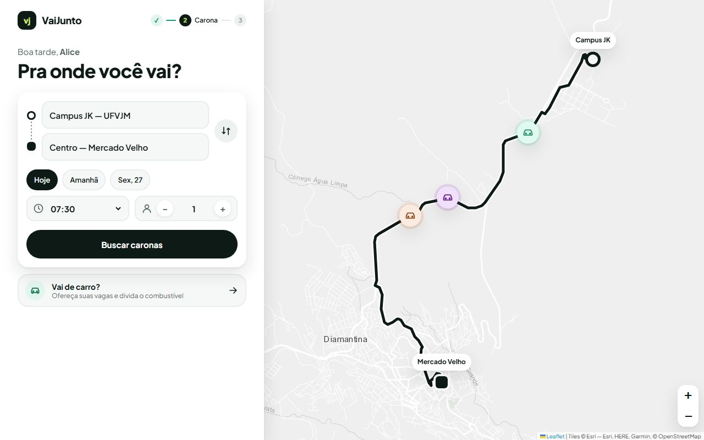 **1. Busca com o nome do cadastro** | 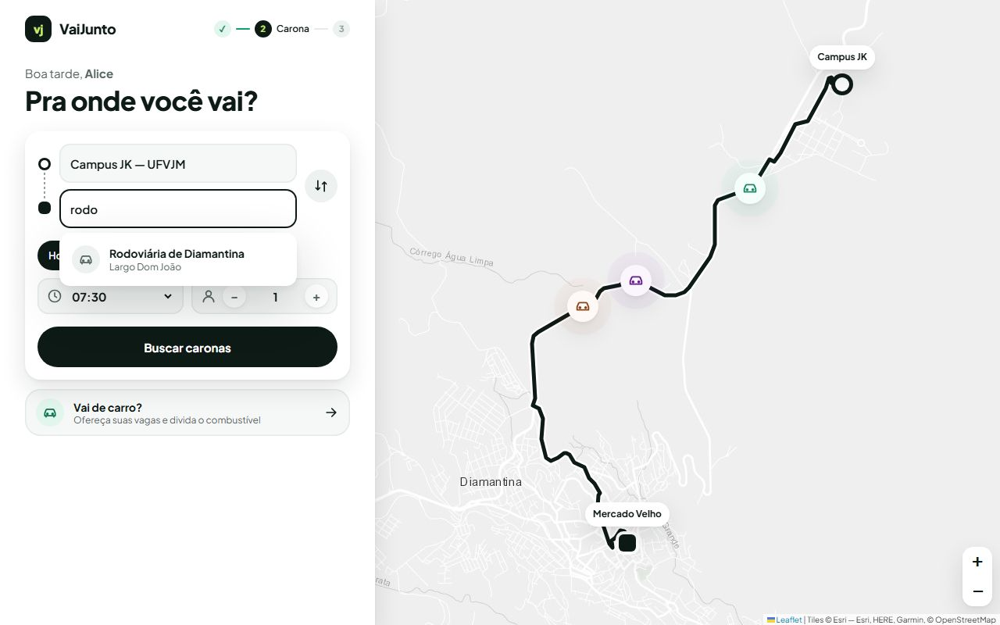 **2. Sugestões ao digitar "rodo"** |
| 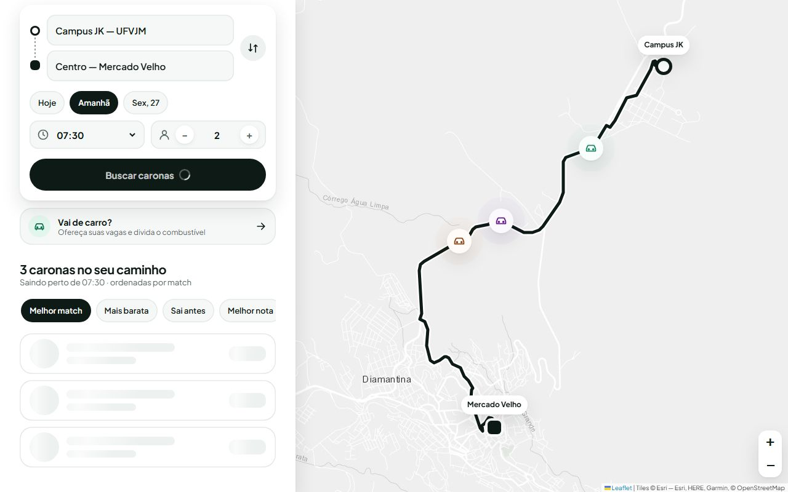 **3. Skeleton durante a busca** | 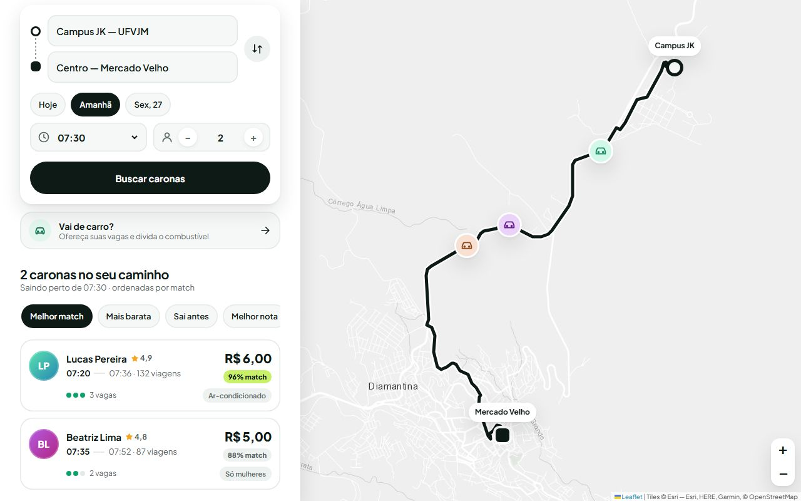 **4. 2 passageiros: 2 caronas por match** |
| 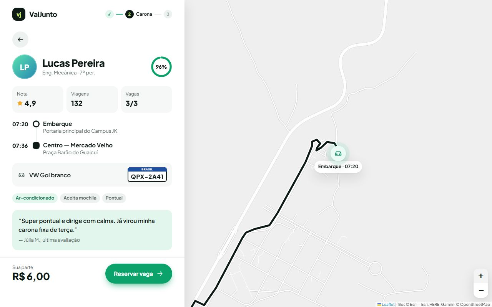 **5. Detalhe do motorista e embarque no mapa** | 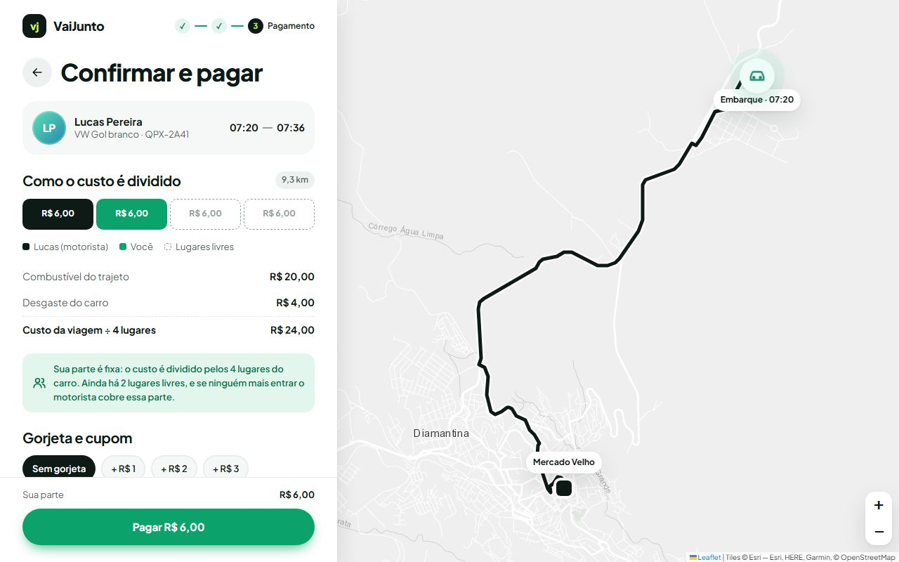 **6. Pagamento cobra R$ 6,00 (1 vaga)** |
| 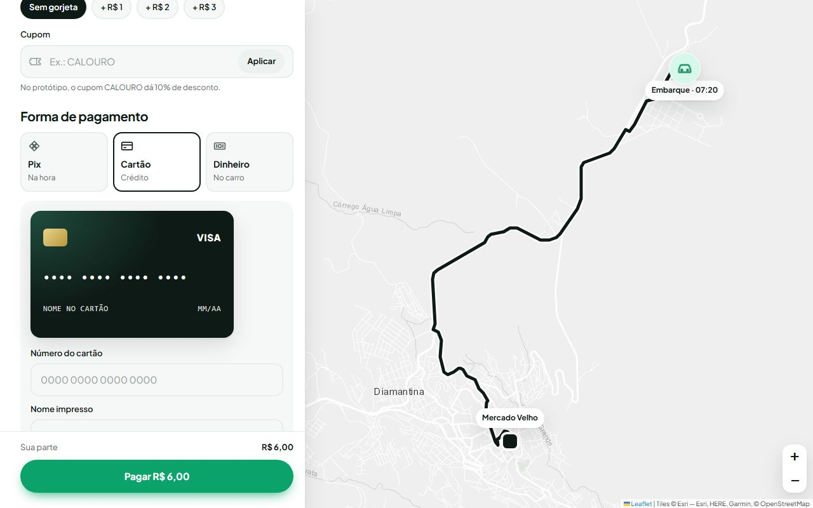 **7. Cartão com os campos em branco** | 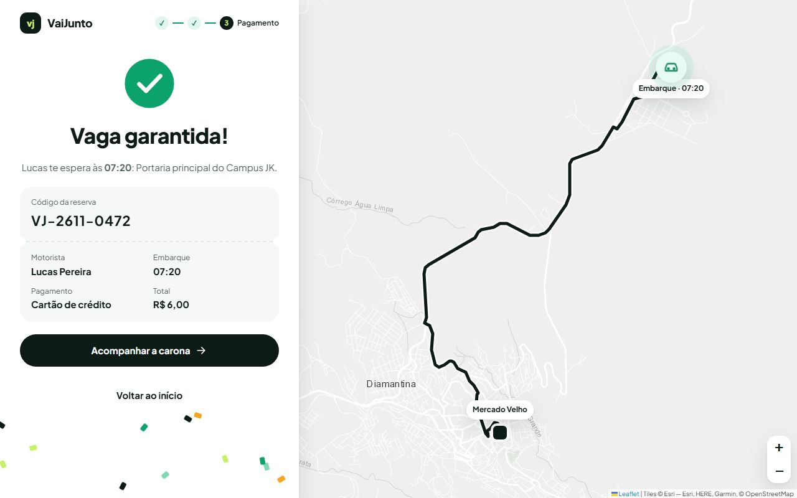 **8. "Vaga garantida!" mesmo assim** |
| 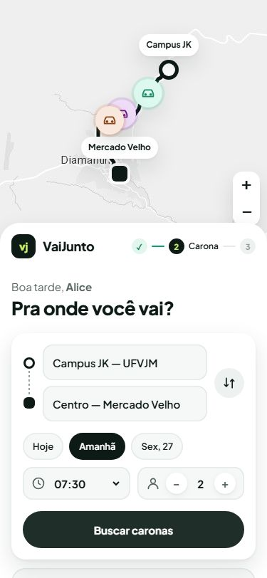 **9. Resultados no celular** | 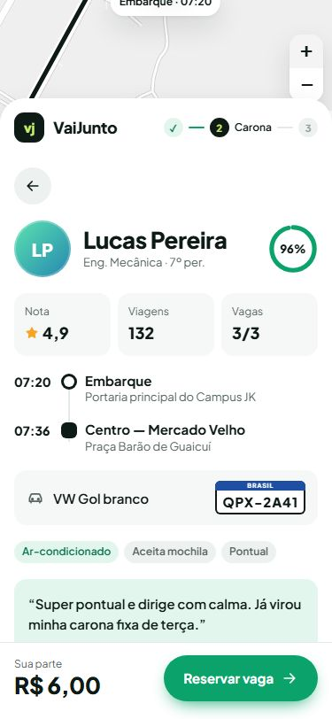 **10. Detalhe no celular** |
| 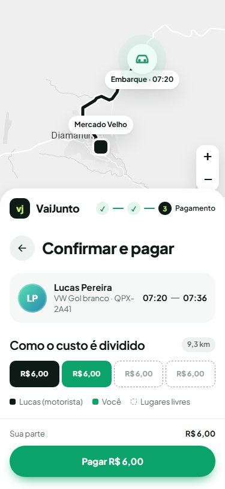 **11. Pagamento no celular (R$ 6,00)** | 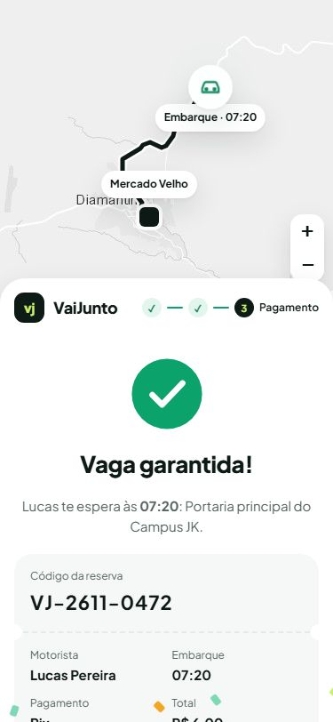 **12. "Vaga garantida!" no celular** |

---

## 4. Problemas encontrados

A tarefa foi concluída, mas dois problemas afetam o resultado da reserva.

**Gravidade:** Alta (impede ou confunde muito) · Média (atrapalha, mas o usuário contorna) · Baixa (detalhe)

| # | Gravidade | Onde | Problema | Sugestão |
|---|---|---|---|---|
| P1 | **Alta** | Busca → Pagamento | A busca filtra por 2 passageiros, mas o pagamento não usa esse número (`pagamento.js` sempre calcula 1 vaga, mesmo com `p=2` na URL). O pagamento cobra e confirma **1 vaga** (R$ 6,00 em vez de R$ 12,00) e a dica de lugares livres fica errada. A colega da usuária ficaria sem lugar. | Ler `p` da URL no pagamento: multiplicar a parte, mostrar 2 cotas como "Você" e escrever "2 vagas" no recibo. |
| P2 | **Alta** | Pagamento, **Cartão** | O botão **Pagar** não confere os campos do cartão. Com número, nome, validade e CVV vazios o pagamento é aprovado e a vaga é confirmada. | Validar os 4 campos (16 dígitos, nome, MM/AA, CVV de 3 ou 4 dígitos) do mesmo jeito que o cadastro faz, com o campo vermelho e a mensagem embaixo. |
| P3 | Baixa | Detalhe do motorista | "Vagas 3/3" pode ser lido como "lotado" (3 de 3 ocupadas), quando quer dizer "3 livres de 3". | Escrever "3 livres" ou "3 de 3 livres". |
| P4 | Baixa | Busca, **Horário** | O horário escolhido não muda os resultados: às 18:00 aparecem caronas das 07:20 às 07:50 com o texto "Saindo perto de 18:00". O mesmo vale para o dia. É limitação do mock, mas pode confundir o usuário no teste. | Filtrar pelo horário ou mostrar um aviso "Protótipo: sempre mostra as caronas da manhã". |

## 5. Pontos positivos

- **Busca pronta para o caso mais comum:** origem e destino já preenchidos com o trajeto Campus JK → Centro.
- **Autocomplete** que filtra enquanto digita e funciona pelo teclado (setas e Enter).
- **Limite de passageiros** claro (1 a 3) e filtro de caronas por vagas funcionando.
- **Skeleton e spinner** durante a busca deixam claro que algo está acontecendo.
- **Ordenação animada** e subtítulo que diz qual ordem está ativa.
- **Detalhe completo do motorista** (nota, viagens, carro, placa, avaliação) e o **mapa acompanha** a escolha, mostrando o ponto de embarque.
- **Voltar do detalhe** mantém a lista e os filtros.
- **Continuidade:** a mesma carona escolhida chega ao pagamento e ao recibo, e a barra de etapas avança até a 3.
- **Funciona igual no celular**, sem erros no console.

## 6. Conclusão

O Teste fixo 2 foi **concluído**: a busca retornou as caronas disponíveis ordenadas por match, o detalhe do motorista abriu corretamente e a reserva chegou até a tela **"Vaga garantida!"**, tanto no computador quanto no celular. No entanto, foram encontrados dois problemas de gravidade alta: **ao buscar para 2 passageiros, o pagamento cobra e confirma apenas 1 vaga (P1)**, e **o pagamento com cartão é aprovado mesmo com os campos em branco (P2)**. Os outros dois pontos (P3 e P4) são detalhes de texto e do mock. O resultado confirma o que os testadores anteriores relataram.
