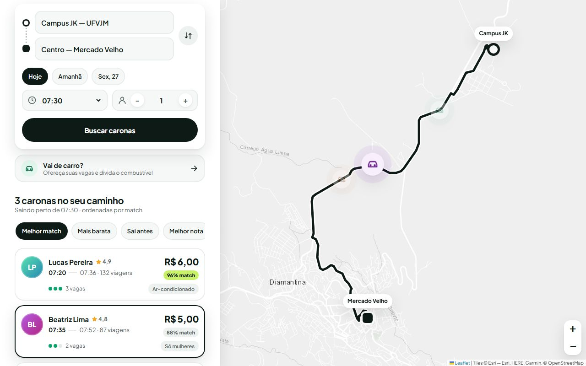
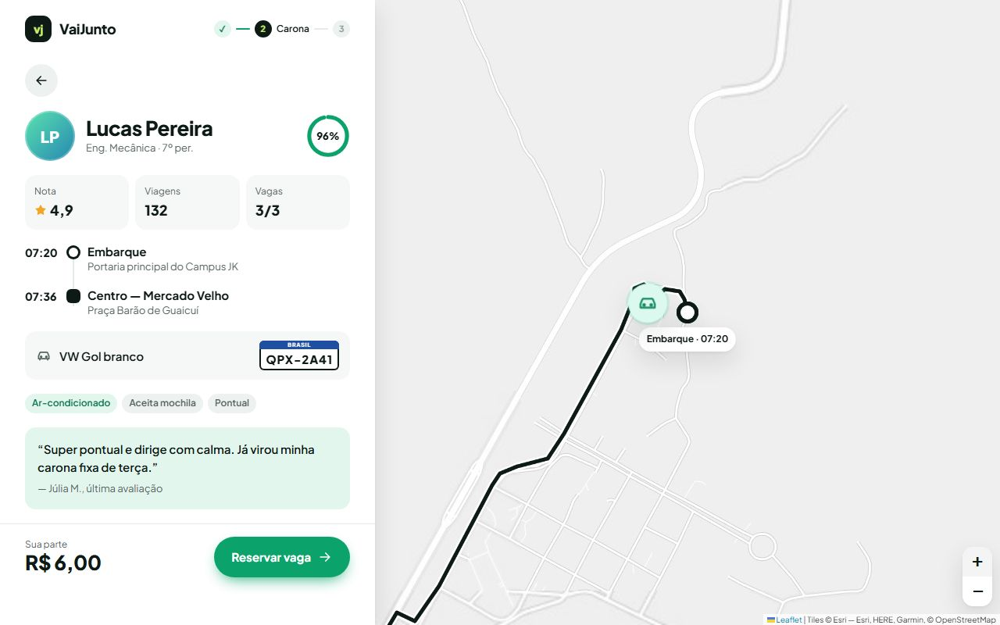
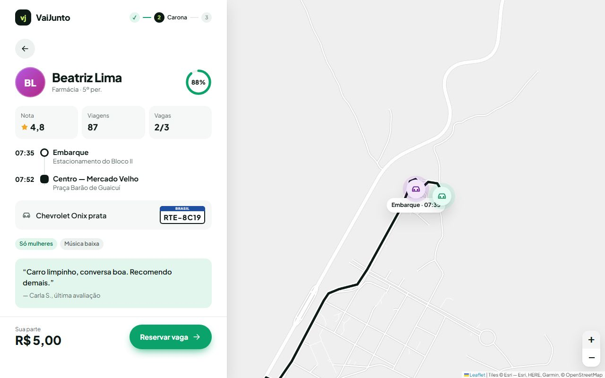
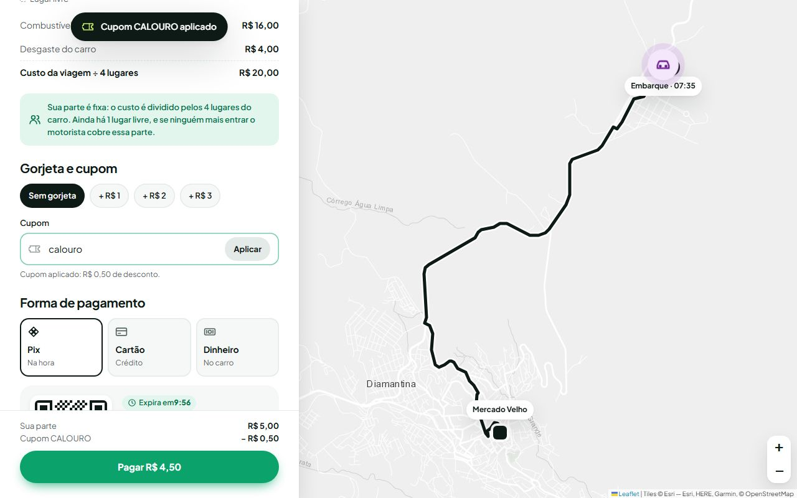
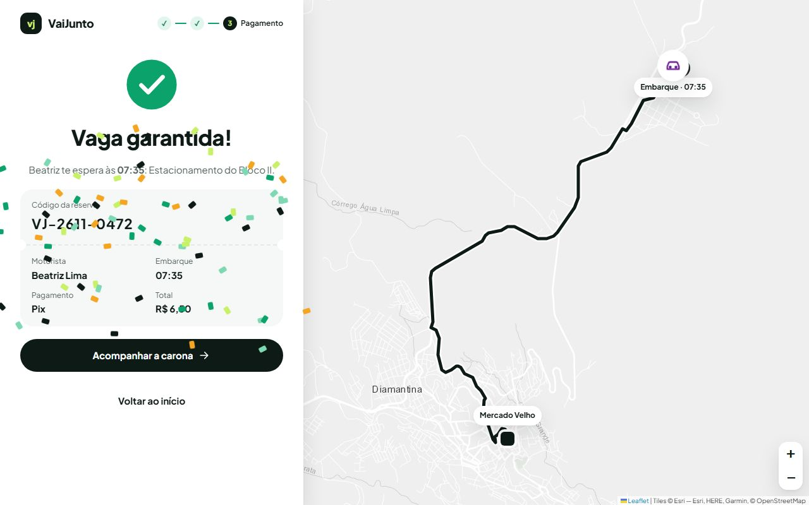
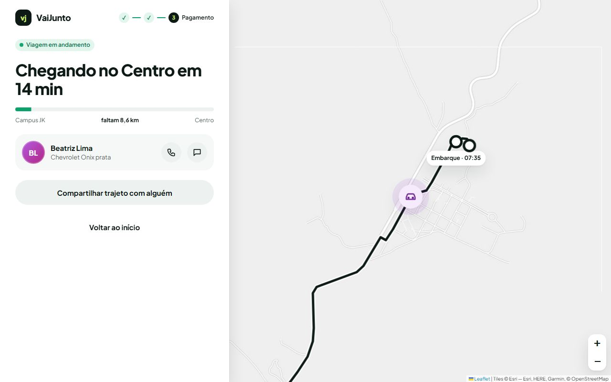
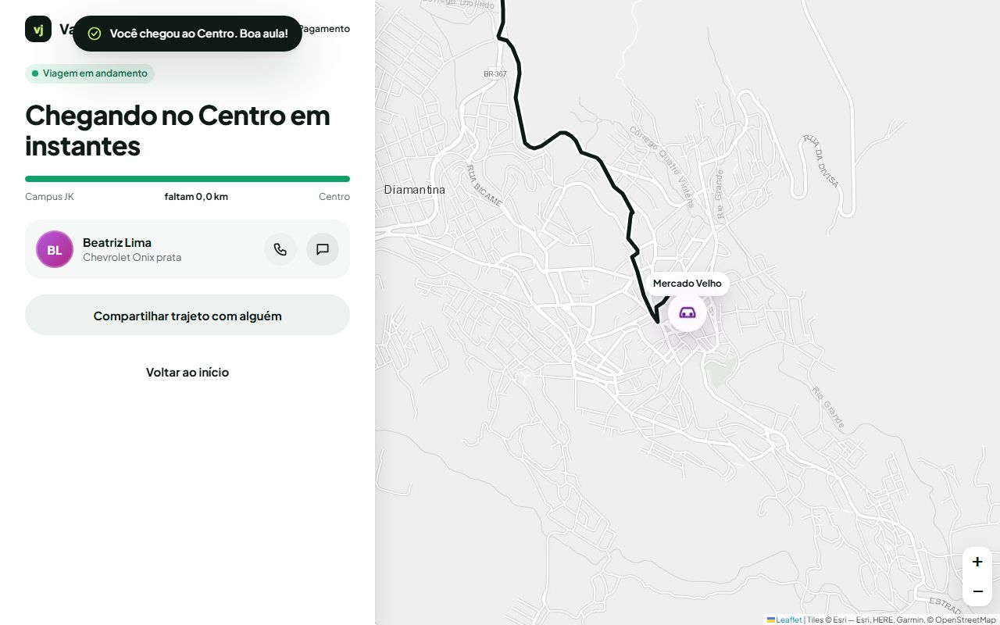
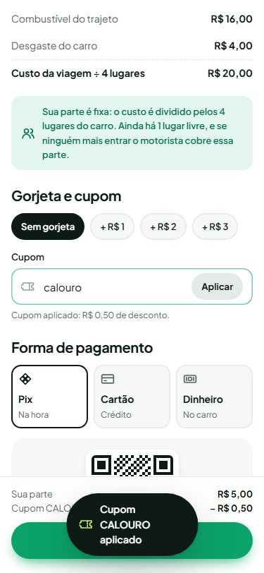
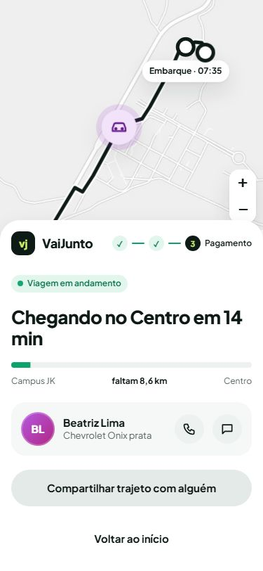

# Teste livre 1 — Navegação ponta a ponta, mapa e cupom

| | |
|---|---|
| **Tipo** | Teste livre de usabilidade |
| **Responsável** | Tester — _(nome)_ |
| **Data** | 26/11/2026 |
| **Protótipo** | VaiJunto (`vaijunto-poc`), fluxo integrado `cadastro/` → `busca/` → `pagamento/` (Devs 1, 2 e 3 + Integração Yago) |
| **Ambiente** | Navegador Chromium, servidor local (`python -m http.server`), tela de computador (1280×800) e de celular (375×812) |
| **Resultado** | **Concluído com sucesso**: navegação fluida da criação de conta até a reserva, mapa interativo, retorno claro das ações e cupom aplicado corretamente, sem problemas de usabilidade |

---

## 1. Objetivo

Teste livre, sem tarefa fechada: o testador usa o protótipo integrado do começo ao fim, como um calouro que vai ao Centro pela primeira vez, observando:

1. a **fluidez da navegação** entre as telas (ir, voltar, recomeçar);
2. a **interação com o mapa da rota**;
3. a **clareza visual** e o **retorno de cada ação** (spinners, avisos, mensagens);
4. a **aplicação de cupom de desconto** no pagamento.

### Persona e dados usados

| Campo | Valor usado |
|---|---|
| Nome completo | Bruno Almeida |
| E-mail institucional | bruno.almeida@ufvjm.edu.br |
| Celular | (38) 99123-4567 |
| Senha | `vaijunto#2026` (fictícia, só para o teste) |
| Perfil | Passageiro |
| Código de verificação | 1234 |
| Carona | Beatriz Lima (Chevrolet Onix prata) |
| Cupons testados | vazio, `CALOURO10`, `calouro`, `XYZ`, `CALOURO` |

> **Nota de versão.** Na primeira rodada deste teste (antes das correções de 26/11) apareceram quatro problemas de usabilidade: o "Voltar" do pagamento apagava a busca; o aviso "Cupom CALOURO aplicado" aparecia em cima do mapa, longe do campo; "Voltar ao início" levava de novo para "Criar conta"; e clicar num carro do mapa não fazia nada. Os quatro foram corrigidos e o teste foi refeito do zero. A tabela abaixo é a rodada final.

---

## 2. Execução passo a passo

| # | Ação do usuário | O que aconteceu | Resultado |
|---|---|---|---|
| 1 | Abriu o protótipo (`index.html`) | Redireciona para "Criar conta" com o mapa da rota ao vivo (carros andando, 9,3 km, ~15 min). | OK |
| 2 | Criou a conta e confirmou o código 1234 | "Tudo pronto, Bruno!" com o cartão do perfil e **Buscar minha primeira carona**. | OK |
| 3 | Foi para a Busca | "Boa tarde, **Bruno**", etapa 2 marcada. Atalho "Vai de carro?" logo abaixo do formulário. | OK |
| 4 | Usou o **+** do zoom e arrastou o mapa | O mapa aproxima e se move normalmente; 3 carros aparecem sobre a rota. | OK |
| 5 | Clicou em **Buscar caronas** | Skeleton, depois "3 caronas no seu caminho". O mapa volta a enquadrar a rota inteira. | OK |
| 6 | Passou o mouse sobre o cartão da Beatriz | O carro dela cresce no mapa e os outros dois ficam apagados. | OK |
| 7 | Clicou direto no carro do Lucas no mapa | Abriu o detalhe do **Lucas Pereira**, com o ponto de embarque no mapa. Voltou com a seta. | OK |
| 8 | Mudou para 3 passageiros, buscou e clicou no carro da Beatriz | Aviso "**Beatriz não tem vagas para 3 passageiros**" e o detalhe não abre. Voltou para 1 passageiro. | OK |
| 9 | Clicou no cartão da Beatriz | Detalhe com o pin "Embarque · 07:35"; o mapa voa até o ponto e o carro anda até ele. | OK |
| 10 | Clicou em **Reservar vaga** | Pagamento com Beatriz Lima, etapa 3, **Pagar R$ 5,00**. | OK |
| 11 | Clicou na seta **Voltar** | Voltou para a Busca **com a mesma lista** (3 caronas, 1 passageiro, 07:30, Hoje), sem precisar buscar de novo. Reservou a Beatriz outra vez. | OK |
| 12 | Clicou em **Aplicar** com o cupom vazio | Campo vermelho com "Digite um cupom." e uma leve tremida. | OK |
| 13 | Tentou `CALOURO10` | "Esse cupom não existe. No protótipo, use CALOURO." Total continua R$ 5,00. | OK |
| 14 | Digitou `calouro` (minúsculo) e deu **Enter** | Aceito: "Cupom aplicado: R$ 0,50 de desconto.", linha "Cupom CALOURO − R$ 0,50" e **Pagar R$ 4,50** (total anima). O aviso "Cupom CALOURO aplicado" aparece **no alto do painel**, sem cobrir o mapa nem os botões. | OK |
| 15 | Escolheu gorjeta **+ R$ 2** | R$ 5,00 + R$ 2,00 − R$ 0,50 = **Pagar R$ 6,50**. | OK |
| 16 | Trocou para um cupom inválido (`XYZ`) e depois voltou para `CALOURO` | Com `XYZ` o desconto sai (R$ 7,00) e aparece o erro; com `CALOURO` volta para R$ 6,50. | OK |
| 17 | Clicou em **Copiar código** do Pix | O botão vira "Copiado!" e o contador "Expira em 9:5x" segue correndo. | OK |
| 18 | Clicou em **Pagar R$ 6,50** | Spinner, confete e "**Vaga garantida!**" com recibo: Beatriz Lima, 07:35, Pix, **R$ 6,50**. | OK |
| 19 | Clicou em **Acompanhar a carona** | "Viagem em andamento": o carro anda pela rota, a barra de progresso enche e o texto diminui ("14 min", "faltam 8,6 km"…). | OK |
| 20 | Clicou em **Mandar mensagem** | Aviso "Chat: fora do escopo do protótipo". | OK |
| 21 | Esperou o fim da viagem | "Chegando no Centro em instantes", "faltam 0,0 km" e o aviso "**Você chegou ao Centro. Boa aula!**". | OK |
| 22 | Clicou em **Voltar ao início** | Voltou para a Busca ("Boa tarde, Bruno"), **sem sair da conta**. O logo também leva para a Busca. | OK |

Nenhum erro apareceu no console do navegador durante o teste.

### Teste no celular (375×812)

O mesmo caminho foi feito no celular (sem o passo do mouse, que não existe na tela de toque). O mapa fica em cima e o painel embaixo; o detalhe, o pagamento com cupom, a confirmação, o acompanhamento e o "Voltar ao início" funcionaram igual. No celular o aviso aparece embaixo, centralizado, e não bloqueia o toque no botão **Pagar**.

---

## 3. Prints

| | |
|---|---|
|  **1. Hover no cartão destaca o carro no mapa** |  **2. Clique no carro abre a carona** |
|  **3. Detalhe com o embarque no mapa** |  **4. "Voltar" do pagamento mantém a lista** |
|  **5. Cupom aplicado, aviso no painel** |  **6. "Vaga garantida!" com R$ 6,50** |
|  **7. Viagem em andamento** |  **8. Chegada ao Centro** |
|  **9. Cupom no celular** |  **10. Acompanhamento no celular** |

---

## 4. Problemas de usabilidade encontrados

Nenhum problema de usabilidade foi encontrado na rodada final.

## 5. Pontos positivos

- **Navegação fluida:** transição animada entre as telas, barra de etapas sempre atualizada e o "Voltar" devolve o usuário exatamente onde estava.
- **Mapa que conversa com a lista:** hover e clique nos carros, ponto de embarque, carro andando até o embarque e durante a viagem.
- **Retorno de cada ação:** skeleton na busca, spinner nos botões, tremida e mensagem nos erros, total animado, confete na confirmação e aviso de chegada.
- **Cupom tolerante:** aceita minúsculas e Enter, explica o erro e diz qual cupom usar no protótipo.
- **Contas sempre fecham:** parte, gorjeta e desconto batem no botão e no recibo.
- **"Início" respeita a conta:** quem já entrou volta para a Busca, não para o cadastro.

## 6. Conclusão

O Teste livre 1 foi **concluído com sucesso**. A navegação ponta a ponta, da criação de conta até a reserva da carona e a interação com o mapa da rota, foi fluida. Também foram avaliados a clareza visual da interface, o retorno das ações e a aplicação de cupom de desconto no pagamento, e tudo funcionou como esperado e **sem problemas de usabilidade**, no computador e no celular. Assim, a experiência de uso do protótipo integrado foi validada.
