# Teste livre 2 — Conta, login, reserva com custos e oferta de carona

| | |
|---|---|
| **Tipo** | Teste livre de usabilidade |
| **Responsável** | Tester — _(nome)_ |
| **Data** | 26/11/2026 |
| **Protótipo** | VaiJunto (`vaijunto-poc`), telas `cadastro/` (Dev 1 Miguel), `busca/` (Dev 2 Maria), `pagamento/` (Dev 3 Humberto) e `oferecer/` (nova, correção pós-teste) |
| **Ambiente** | Navegador Chromium, servidor local (`python -m http.server`), tela de computador (1280×800) e de celular (375×812) |
| **Resultado** | **Concluído com sucesso**: criação de conta e login validados, busca e reserva com cálculo de custos corretos e oferta de viagem publicada, sem erros |

---

## 1. Objetivo

Teste livre, sem roteiro fechado: a testadora usa o protótipo como uma estudante que **dirige até o campus** e às vezes pega carona. O foco foi:

1. criar conta e entrar de novo (login), incluindo os erros comuns de quem digita rápido;
2. buscar e reservar uma carona conferindo a conta da divisão do custo;
3. **oferecer uma viagem** como motorista.

### Persona e dados usados

| Campo | Valor usado |
|---|---|
| Nome completo | Carla Souto |
| E-mail institucional | carla.souto@ufvjm.edu.br |
| Celular | (38) 98888-7777 |
| Senha | `motorista2026` (fictícia, só para o teste) |
| Perfil | Motorista |
| Código de verificação | 9012 |
| Carro oferecido | Fiat Argo vermelho, placa PWN-5H07 |

> **Nota de versão.** Na primeira rodada deste teste (antes das correções de 26/11) foram achados problemas: não havia tela para oferecer carona, o login aceitava campos vazios, senha errada e e-mail de fora da UFVJM, e a dica de divisão do custo prometia uma redução impossível. Esses pontos foram corrigidos e o teste foi refeito do zero. A tabela abaixo é a rodada final.

---

## 2. Execução passo a passo

### A) Criar conta como motorista

| # | Ação do usuário | O que aconteceu | Resultado |
|---|---|---|---|
| 1 | Preencheu o cadastro, escolheu **Motorista**, aceitou os termos e clicou em **Criar conta** | Spinner e tela "Confira seu e-mail" com o e-mail digitado (carla.souto@ufvjm.edu.br). | OK |
| 2 | Digitou o código 9, 0, 1, 2 e clicou em **Confirmar código** | "**Tudo pronto, Carla!**", cartão com avatar "CS", e-mail e etiqueta "Motorista". | OK |
| 3 | Olhou os botões da tela final | Como é motorista, o botão principal é **Oferecer minha primeira carona** e o secundário é **Buscar uma carona**. | OK |

### B) Oferecer uma viagem

| # | Ação do usuário | O que aconteceu | Resultado |
|---|---|---|---|
| 4 | Clicou em **Oferecer minha primeira carona** | Abriu "**Oferecer carona**" ("Carla, vai de carro?"), etapa 2 Carona. Trajeto já vem Campus JK → Centro, embarque na Portaria principal, saída 07:20, 3 vagas. O mapa mostra a rota e o ponto de embarque. | OK |
| 5 | Conferiu a divisão com 3 vagas | "Custo da viagem ÷ 4 lugares = R$ 22,00" (combustível R$ 18,00 + desgaste R$ 4,00), **cada passageiro paga R$ 5,50** e a dica explica que, com as 3 vagas preenchidas, ela recebe R$ 16,50 e paga só a sua parte. | OK |
| 6 | Clicou em **Publicar carona** sem preencher o carro | Os dois campos ficaram vermelhos: "Diga o modelo e a cor do carro." e "Placa no formato ABC-1D23 ou ABC-1234.". | OK |
| 7 | Digitou a placa incompleta `pwn5h0` | A máscara deixou em maiúsculas com hífen (**PWN-5H0**) e manteve o erro. | OK |
| 8 | Escolheu embarque no Estacionamento do Bloco II, **Amanhã**, 07:00 e baixou para **2 vagas** | O pin do mapa foi para o novo ponto. A conta mudou na hora: ÷ 3 lugares, **R$ 7,33** por passageiro, barra com "Você" + 2 cotas. | OK |
| 9 | Tentou subir para 6 vagas | O contador para em **4** e o botão **+** fica desativado. | OK |
| 10 | Voltou para 2 vagas, preencheu "Fiat Argo vermelho", placa `pwn5h07` e marcou **Ar-condicionado** | Placa virou **PWN-5H07**; os dois campos ficaram verdes com ícone de confirmação. | OK |
| 11 | Clicou em **Publicar carona** | Spinner e tela "**Carona publicada!**" com código (VJ-OF-…), saída "Amanhã, 07:00", 2 vagas, trajeto Campus JK → Centro, embarque Estacionamento do Bloco II, carro e placa, **R$ 7,33 por passageiro**. O mapa aproxima o ponto de embarque. | OK |
| 12 | Clicou em **Voltar ao início** | Foi para a Busca com o nome (sem sair da conta), onde há o atalho "**Vai de carro?** Ofereça suas vagas". | OK |

### C) Login

| # | Ação do usuário | O que aconteceu | Resultado |
|---|---|---|---|
| 13 | Na aba **Já tenho conta**, clicou em **Entrar** com tudo vazio | Não entrou. "Use seu e-mail que termina em @ufvjm.edu.br." e "Digite sua senha (mínimo de 8 caracteres).", com o cursor no e-mail. | OK |
| 14 | Tentou `carla.souto@gmail.com` com senha de 1 letra | Não entrou, mesmas duas mensagens. | OK |
| 15 | Usou o e-mail certo com a senha `senhaerrada` | Spinner e, em seguida, "**Senha incorreta.** Confira e tente de novo." com a senha selecionada para redigitar. | OK |
| 16 | Entrou com `carla.souto@ufvjm.edu.br` / `motorista2026` | "**Que bom te ver, Carla!**", "Você entrou na sua conta. Pra onde vamos hoje?", perfil **Motorista** lembrado do cadastro, botões **Oferecer uma carona** e **Buscar uma carona**. | OK |
| 17 | Entrou com uma conta que não foi criada neste navegador (`joao@ufvjm.edu.br`) | Entra como "Joao" (nome tirado do e-mail), perfil Passageiro. Comportamento esperado do mock para contas de demonstração. | OK |
| 18 | Clicou em **Esqueci minha senha** sem e-mail; depois com o e-mail | Sem e-mail: erro no campo e nenhum envio. Com e-mail: aviso "Link de nova senha enviado para carla.souto@ufvjm.edu.br". | OK |

### D) Busca e reserva com cálculo de custos

Regra conferida: **sua parte = (combustível + desgaste) ÷ lugares do carro**.

| # | Ação do usuário | O que aconteceu | Resultado |
|---|---|---|---|
| 19 | Conferiu as 3 caronas | Lucas: R$ 24,00 ÷ 4 = **R$ 6,00**. Beatriz: R$ 20,00 ÷ 4 = **R$ 5,00**. Rafael: R$ 21,00 ÷ 3 = **R$ 7,00**. Os mesmos valores aparecem na busca, no detalhe e no pagamento. | OK |
| 20 | Conferiu a barra de cotas | Lucas: motorista, você, 2 lugares livres. Beatriz: motorista, 1 outro passageiro, você, 1 lugar livre. Rafael: motorista, 1 outro passageiro, você (carro lota). A dica explica que a parte é fixa e o motorista cobre os lugares livres. | OK |
| 21 | Reservou com a Beatriz, aplicou `CALOURO` e gorjeta de R$ 1 | Sua parte R$ 5,00 − cupom R$ 0,50 + gorjeta R$ 1,00 = **Pagar R$ 5,50**. | OK |
| 22 | Pagou em **Dinheiro** | "**Vaga garantida!**", recibo com Beatriz Lima, embarque 07:35, pagamento Dinheiro, total R$ 5,50. | OK |

Nenhum erro apareceu no console do navegador durante o teste.

### Teste no celular (375×812)

O roteiro A–D foi repetido no celular. A tela de oferecer fica com o mapa em cima e o formulário embaixo; o trajeto empilha os campos, o carro e a placa ficam um embaixo do outro e o rodapé com "Cada passageiro paga" e **Publicar carona** fica fixo. Nada estoura a largura da tela. Login, validações e reserva funcionaram igual.

---

## 3. Prints

| | |
|---|---|
| 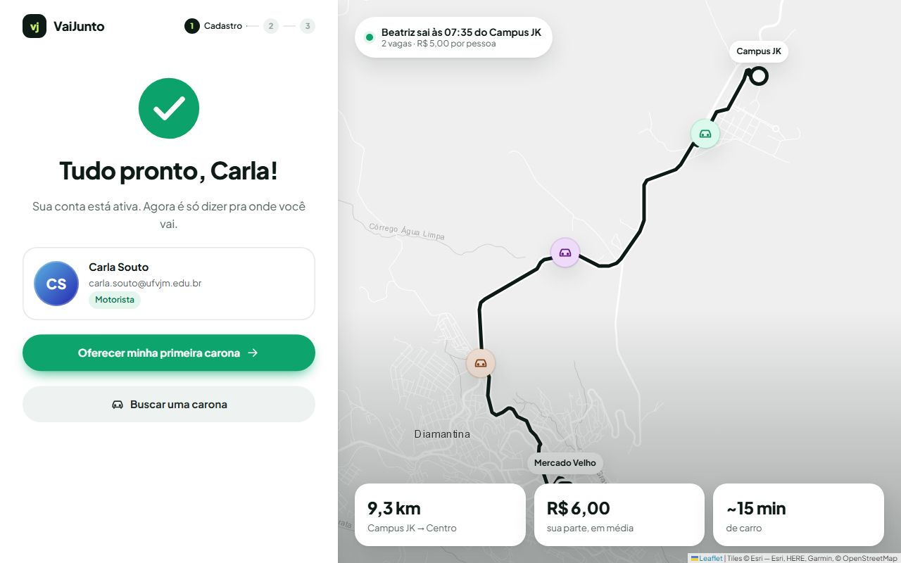 **1. Conta de motorista criada** | 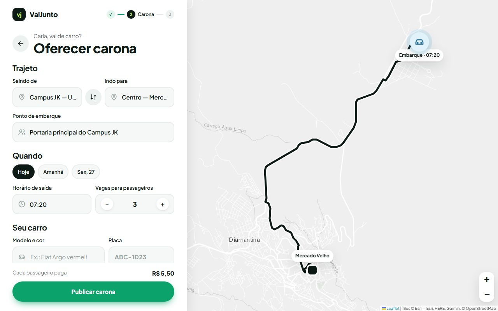 **2. Tela Oferecer carona** |
| 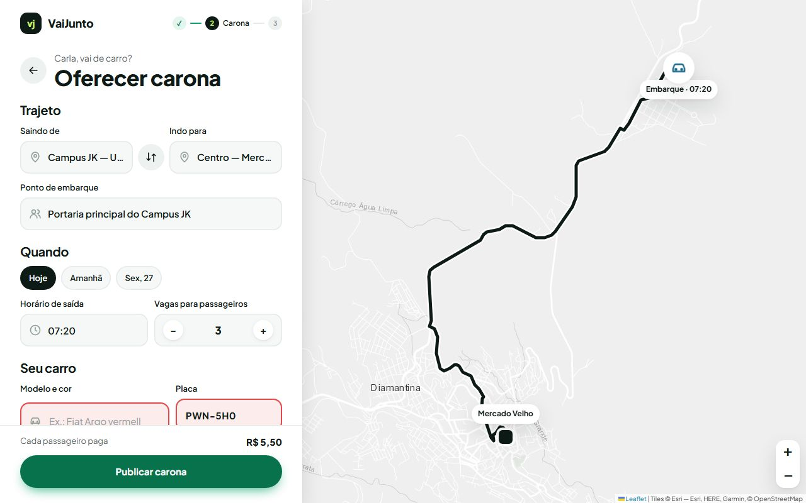 **3. Publicar sem carro e placa** | 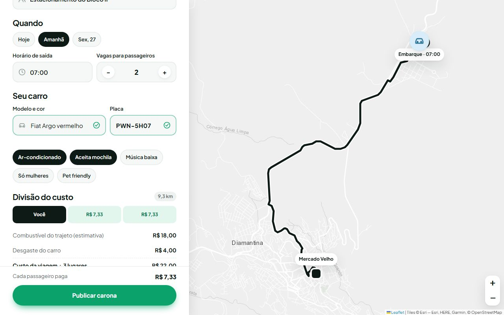 **4. 2 vagas, R$ 7,33 por passageiro** |
| 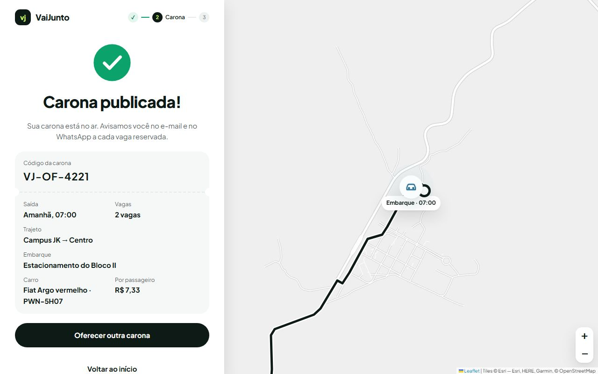 **5. "Carona publicada!"** | 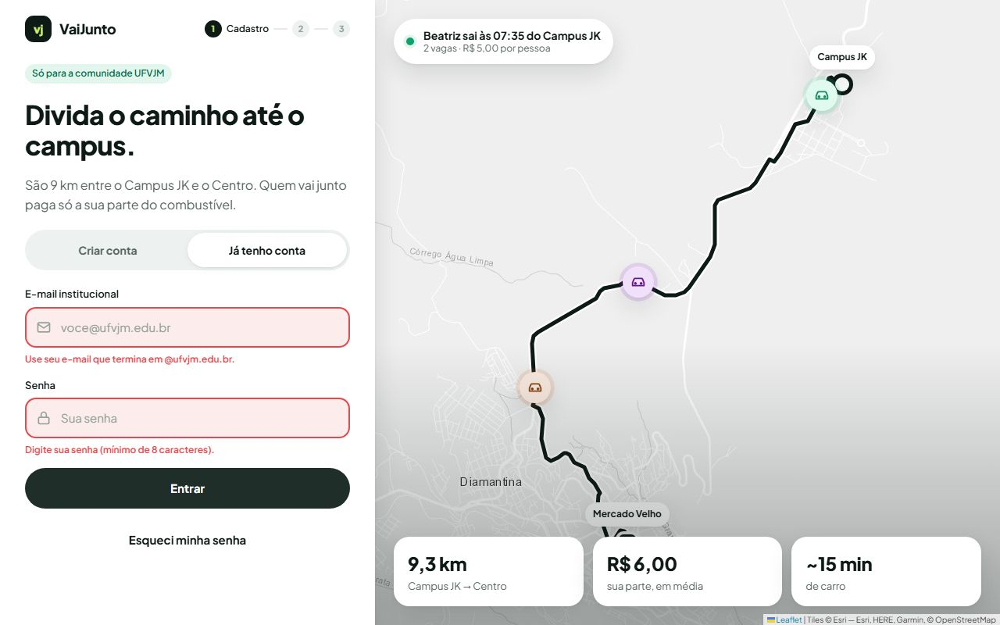 **6. Login vazio recusado** |
| 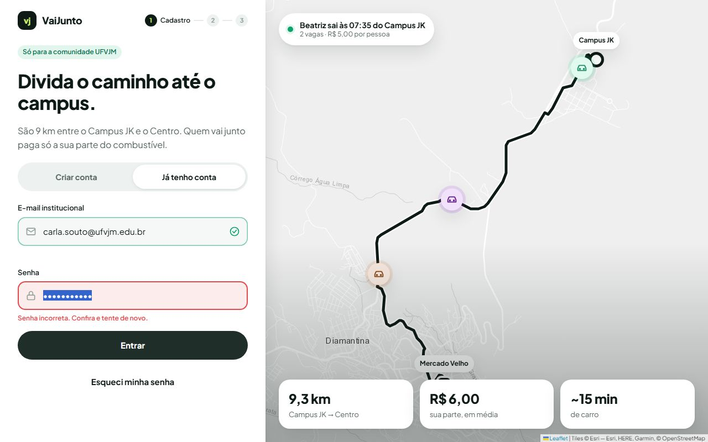 **7. Senha incorreta** | 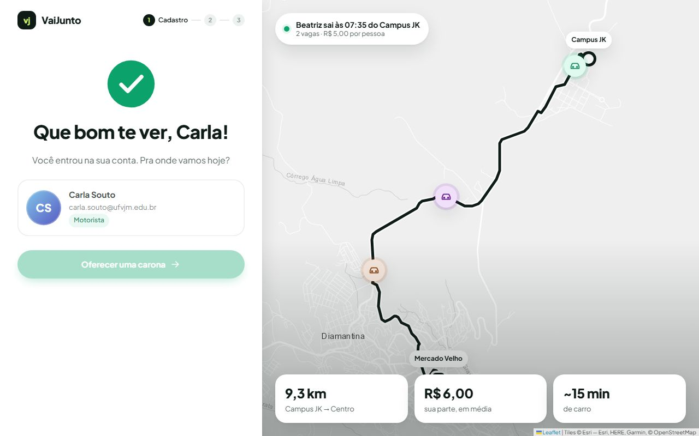 **8. "Que bom te ver, Carla!"** |
| 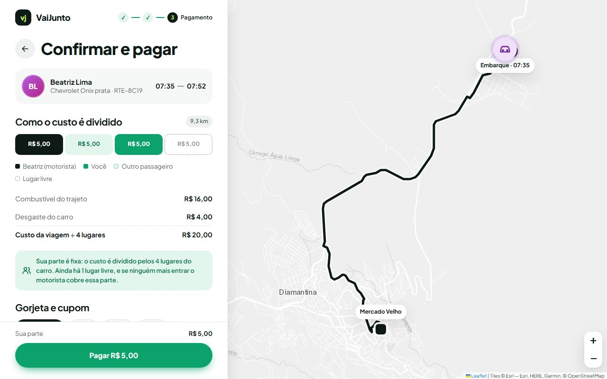 **9. Divisão por lugares (Beatriz)** | 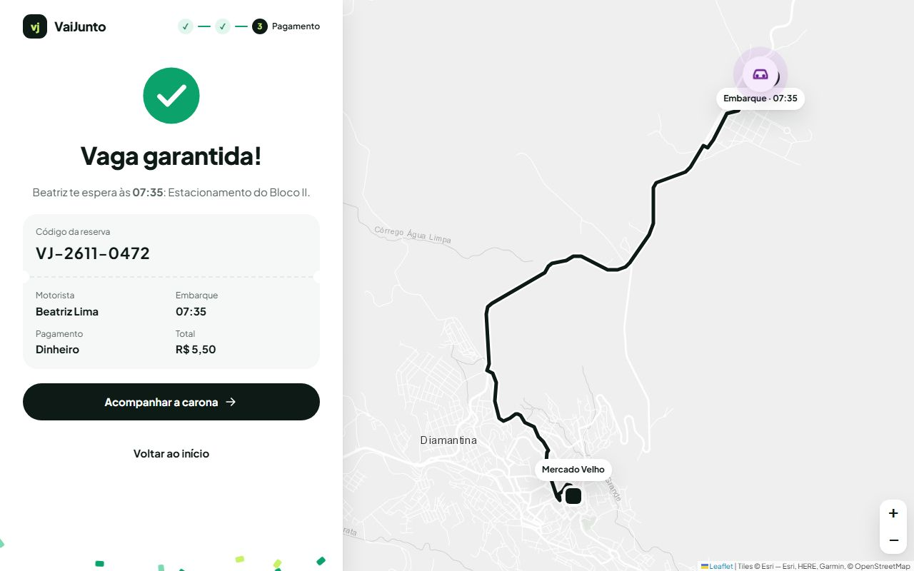 **10. Reserva confirmada (R$ 5,50)** |
| 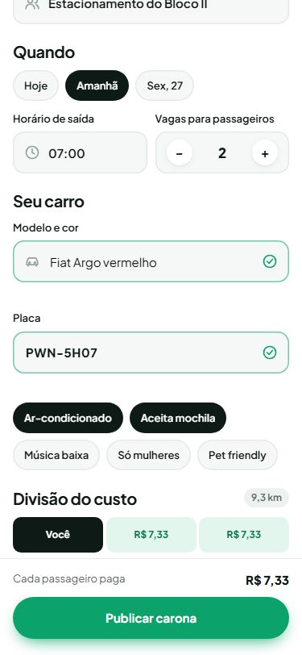 **11. Oferecer carona no celular** | 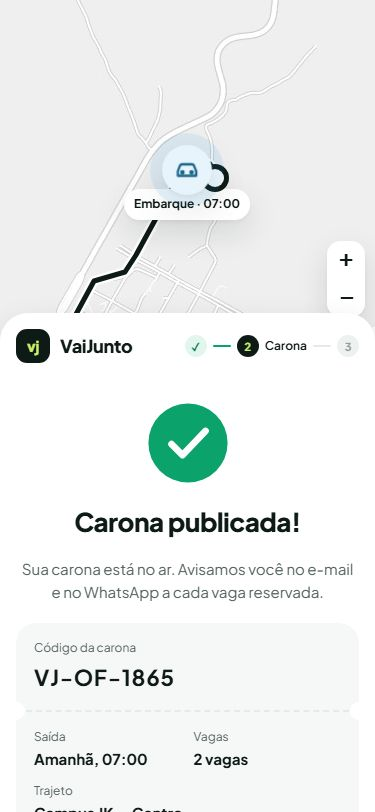 **12. Carona publicada no celular** |

---

## 4. Problemas de usabilidade encontrados

Nenhum problema de usabilidade foi encontrado na rodada final. Ficam só observações sobre o que o protótipo simula:

- O código de verificação aceita quaisquer 4 dígitos (como já diz a dica na tela).
- O login só confere a senha de contas criadas no mesmo navegador; outros e-mails @ufvjm.edu.br entram como conta de demonstração.
- A carona publicada não vai para a lista da Busca (não há servidor).

## 5. Pontos positivos

- **Caminho do motorista claro:** o perfil escolhido no cadastro decide o botão principal da tela final.
- **Formulário de oferta curto,** já preenchido com o trajeto mais comum.
- **Divisão do custo ao vivo** ao mudar o número de vagas, com a mesma regra e o mesmo visual do pagamento.
- **Validação com mensagens que dizem o que fazer** no login, no "Esqueci minha senha" e no carro/placa.
- **Máscara de placa** automática (maiúsculas e hífen).
- **Login reconhece a conta:** lembra nome e perfil e recusa senha errada.
- **Contas fecham:** valores iguais na busca, no detalhe, no pagamento e no recibo, inclusive com cupom e gorjeta.

## 6. Conclusão

O Teste livre 2 foi **concluído com sucesso**. O fluxo de criação de conta e login foi validado, incluindo a autenticação por e-mail institucional e a confirmação de cadastro pelo código. As funcionalidades principais, como a **busca e a reserva de caronas com cálculo de custos** e o **oferecimento de viagens**, funcionaram como esperado e sem erros, no computador e no celular. Assim, todas as etapas essenciais do protótipo foram validadas.
